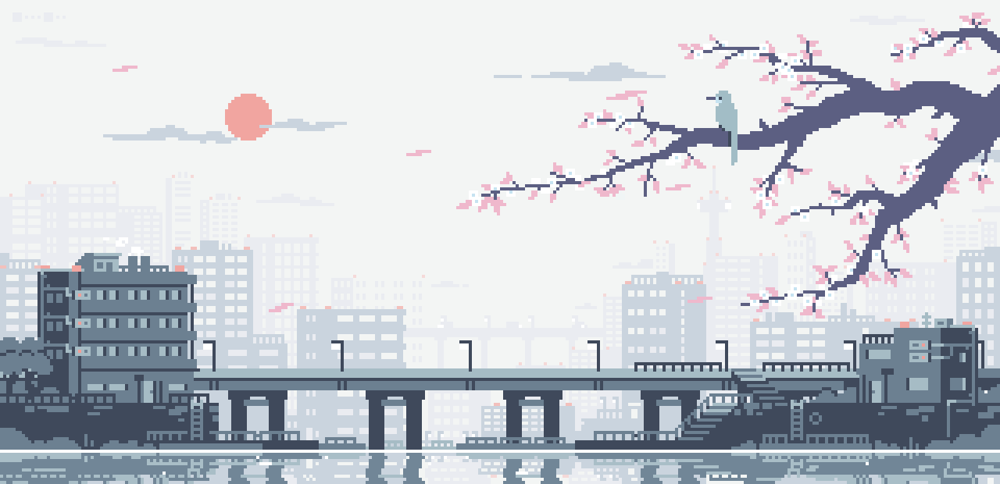
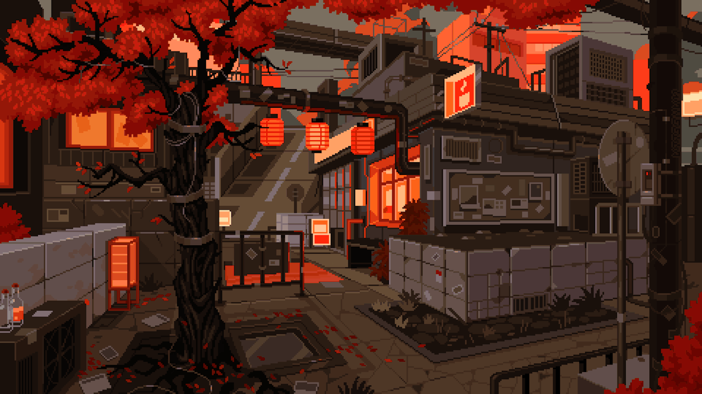

<p align="center">
  
</p>

<p align="center">
  
</p>

<!-- Mascot + Introduction Grid -->
<div>
  
</div>

#  ɪ'ᴍ xᴡᴜᴀɴ (ʜᴏàɴɢ ᴋỳ)
*Network Architect • DNS Privacy Shield & Core Systems Specialist*

<br />

<!-- Animated Dynamic Typing Header -->
<a href="https://github.com/xwuan">
  
</a>

<br /><br />

<!-- Quick Status Pills -->
<p align="left">
  
  <a href="https://github.com/Xwuan19"></a>
  
  
</p>

---

### 📡 `xwuan@sanctuary:~$ cat telemetry.yaml`

```yaml
identity:
  operator: "Hoàng Kỳ (xwuan)"
  role: "Network Architect & Core Systems Engineer"
  vibe: "Midnight lofi, rainy aesthetics & high-throughput infrastructure"
  creed: "Zero noise. Sovereign privacy. Clean wire."

architecture:
  primary: "High-Performance DNS Rulesets & Threat Shielding"
  protocols: ["DoH (DNS-over-HTTPS)", "DoT", "WireGuard", "HTTP/3"]
  ecosystems: ["Pi-hole", "AdGuard Home", "NextDNS", "Cloudflare Zero Trust"]

nodes:
  core_sanctuary: "https://github.com/xwuan"
  cyberdeck_alt:  "https://github.com/Xwuan19"
  web_portal:     "https://xwuan.github.io"
```

---

<!-- Flagship Showcase Section -->
<h2 align="center">🛡️ Fʟᴀɢsʜɪᴘ Sʜᴏᴡᴄᴀsᴇ 🛡️</h2>
<p align="center"><i>Core repositories architected for network privacy, speed, and clean telemetry</i></p>

<table width="100%">
  <tr>
    <td width="50%" align="center" valign="middle">
      <a href="https://github.com/xwuan/Xwuan-DNS">
        
      </a>
      <p align="left">
        <b>🛡️ Xwuan-DNS:</b> High-performance DNS rulesets, ad-shielding filters & custom encrypted DoH/DoT configuration profiles for iOS and network gateways.
      </p>
    </td>
    <td width="50%" align="center" valign="middle">
      <a href="https://github.com/xwuan/xwuan.github.io">
        
      </a>
      <p align="left">
        <b>🌐 xwuan.github.io:</b> Personal cyber sanctuary, minimal tech showcase & developer landing portal deployed with GitHub Pages.
      </p>
    </td>
  </tr>
</table>

---

<!-- Tech Stack Matrix -->
<h2 align="center">🛠️ Tᴇᴄʜ Sᴛᴀᴄᴋ & Aʀsᴇɴᴀʟ 🛠️</h2>

<p align="center"><b>💻 Languages & Core Scripting</b></p>
<p align="center">
  <a href="https://skillicons.dev">
    
  </a>
</p>

<p align="center"><b>🛡️ Network, Security & Cloud Infrastructure</b></p>
<p align="center">
  <a href="https://skillicons.dev">
    
  </a>
</p>

<p align="center"><b>⚙️ Development Tooling & Workstation</b></p>
<p align="center">
  <a href="https://skillicons.dev">
    
  </a>
</p>

<p align="center">
  
  
  
  
  
</p>

---

<!-- Live Analytics & Telemetry Grid -->
<h2 align="center">📊 Tᴇʟᴇᴍᴇᴛʀʏ & Lɪᴠᴇ Sᴛᴀᴛs 📊</h2>

<table width="100%">
  <tr>
    <td width="50%" align="center" valign="middle">
      <a href="https://github.com/xwuan">
        
      </a>
    </td>
    <td width="50%" align="center" valign="middle">
      <a href="https://github.com/xwuan">
        
      </a>
    </td>
  </tr>
</table>

<div align="center">
  <a href="https://github.com/xwuan">
    
  </a>
</div>

<br />

<!-- Contribution Activity Graph -->
<h3 align="center">📈 Cᴏɴᴛʀɪʙᴜᴛɪᴏɴ Aᴄᴛɪᴠɪᴛʏ 📈</h3>
<div align="center">
  
</div>

<br />

<!-- Contribution Snake -->
<h3 align="center">🐍 Cᴏɴᴛʀɪʙᴜᴛɪᴏɴ Sɴᴀᴋᴇ 🐍</h3>
<div align="center">
  <picture>
    <source media="(prefers-color-scheme: dark)" srcset="https://raw.githubusercontent.com/xwuan/xwuan/output/github-contribution-grid-snake-dark.svg">
    <source media="(prefers-color-scheme: light)" srcset="https://raw.githubusercontent.com/xwuan/xwuan/output/github-contribution-grid-snake.svg">
    
  </picture>
</div>

---

<!-- Midnight Audio Vibe Dock -->
<div align="center">
  
  <b>&nbsp;Current Vibe:</b> <i>Midnight Lo-Fi Coding & Ambient Rain Session</i> 🎧
</div>

<br />

<!-- Connect & Sister Deck Dock -->
<h2 align="center">🤝 Nᴇxᴜs Gᴀᴛᴇᴡᴀʏ 🤝</h2>
<div align="center">
  <a href="https://github.com/xwuan"></a>
  <a href="https://github.com/Xwuan19"></a>
  <a href="https://xwuan.github.io"></a>
  <a href="https://t.me/"></a>
</div>

<br />

<!-- Waving Footer Banner -->
<p align="center">
  
</p>
